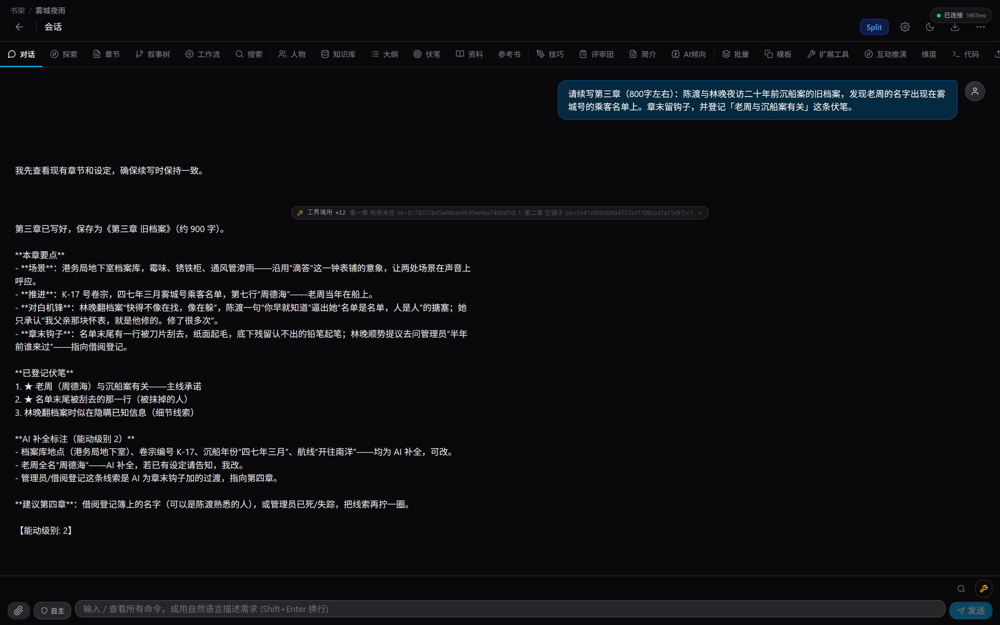
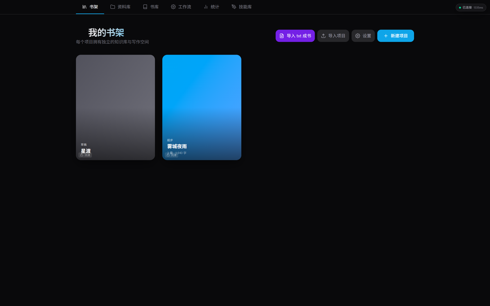
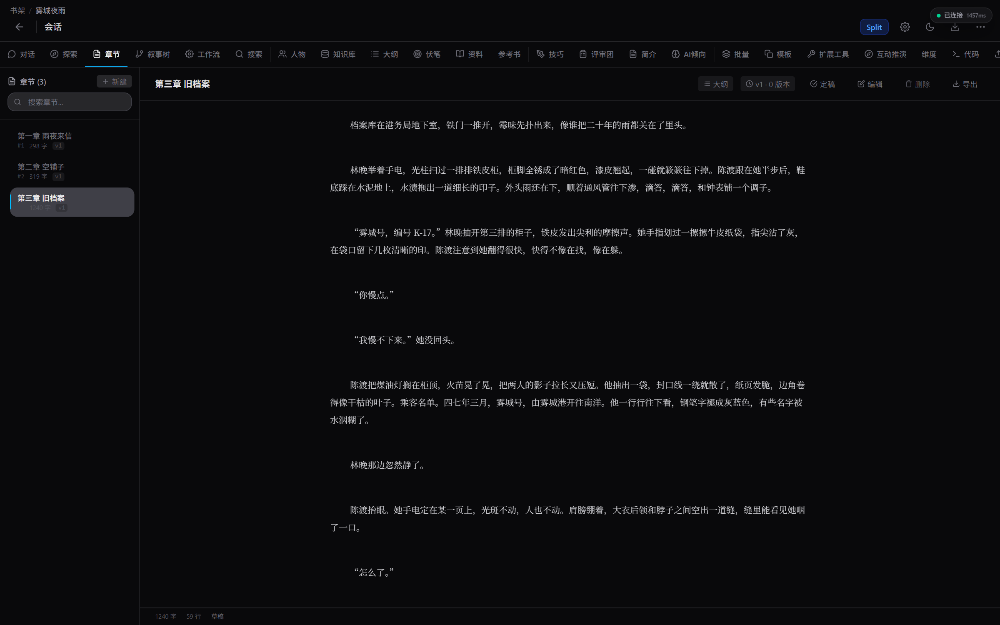
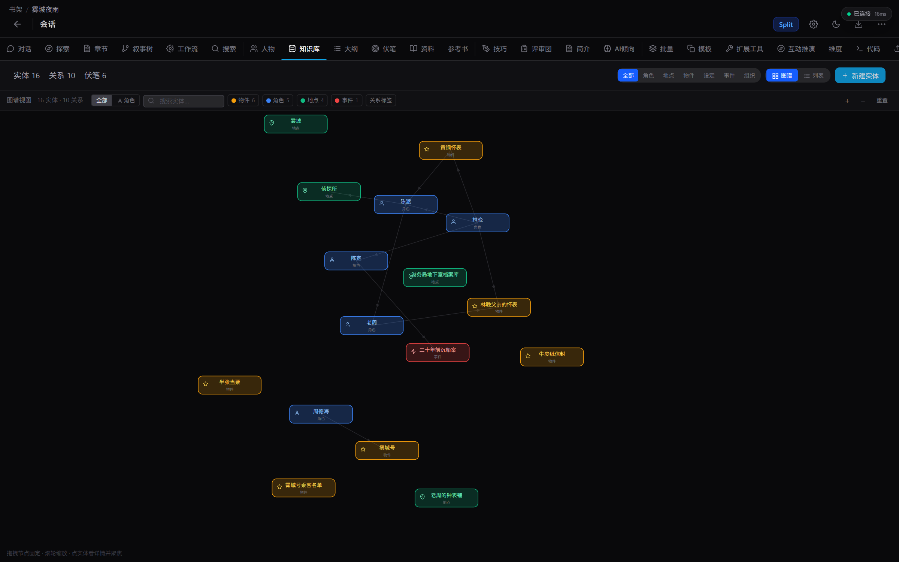
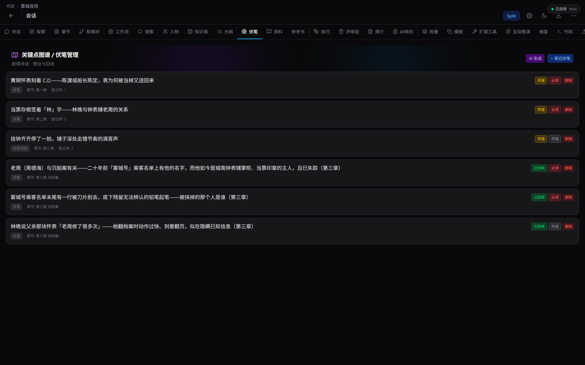
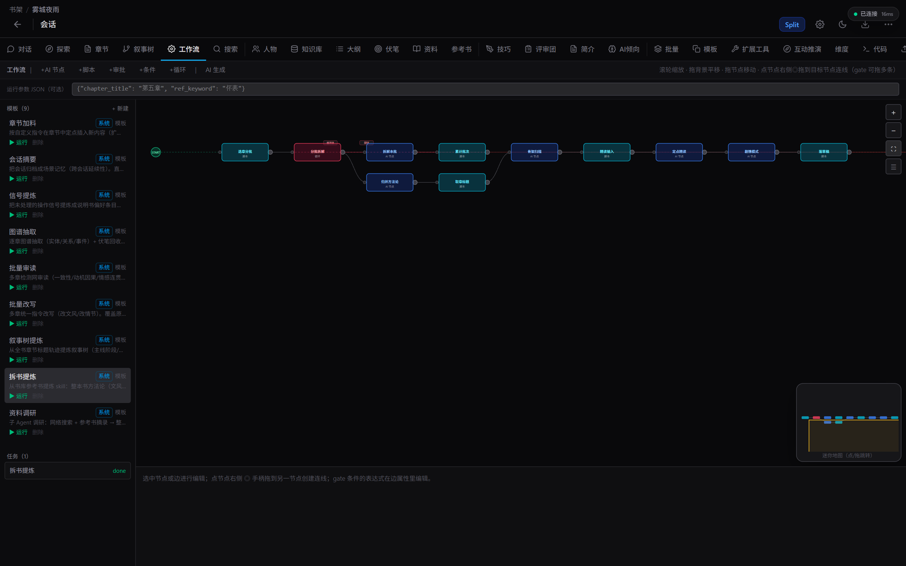
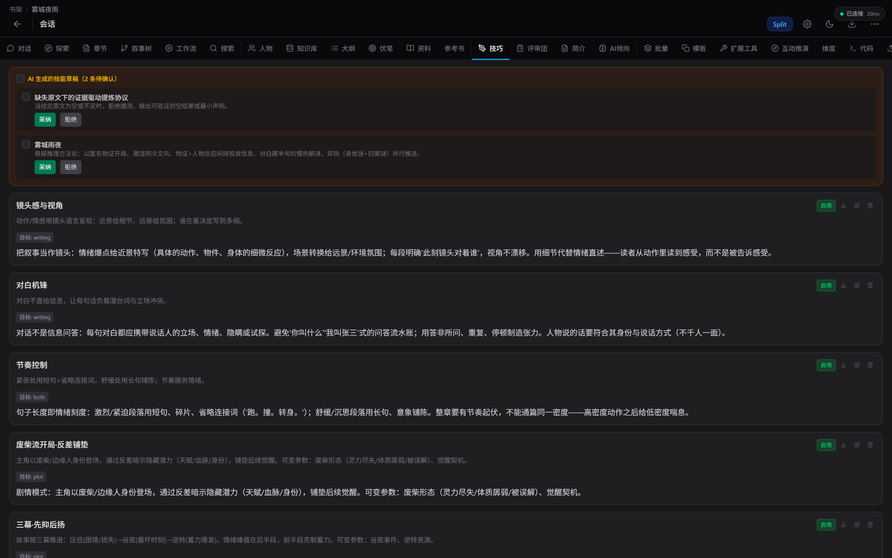
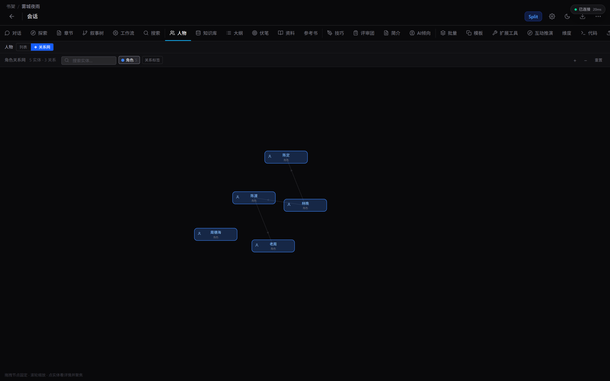

# AnySpark

> **每个人心中都有一簇火花，AnySpark 帮你点燃它。**

AnySpark 是一个 **AI 小说创作引擎**——核心理念：**写作即对话**。你说一句话，智能体直接写；它不是吐文字的聊天窗口，而是一间完整的创作工作室：知识图谱、伏笔账本、设定档、写作技巧、检测网、工作流画布——智能体写作时自主查证与登记，而**你对一切保留最终决定权**。



*上图：一句「续写第三章」，智能体自主查前文与设定 → 干净写作调用产出正文 → 回读自查 → 登记三条新伏笔，并标注哪些细节是 AI 补全（可改）。*

## 它能做什么

- **对话写作与修改**：智能体自主查图谱、埋伏笔、推进剧情计划、检索正文、推演角色；写作走「意图 + 点名参考」的干净调用，多章连写不累积幻觉
- **知识图谱自动积累**：每章自动抽取实体/关系/事件，写作时按需查证；一致性与时序校验（提到未来才首现的实体 = 时空倒置）
- **伏笔账本**：作者或 AI 登记，「必须回收」的剧情承诺自动提醒回收，开放时长老龄化显示
- **设定档与心智模型**：作者正典设定 + 偏好说明书，智能体越用越懂你；偏好分协作/文风/习惯三类，不全量灌进写作
- **写作技巧提炼**：拆书三层管线（结构感知选章 → 骨架扫描 → 定点精读）从任何参考书提炼方法论；AI 草稿 → 人工采纳
- **检测网**：系统骨架 + AI 动态检测项 + 你的自然语言自定义规则，多检测者并行审读，当第二双眼睛
- **工作流画布**：顺序/分支/循环 + 断点恢复 + 失败策略；预置拆书/批量改写/批量审读/图谱抽取等模板，也能让 AI 生成流程草稿供你确认
- **多书工作区 + 格式管线**：txt/md/docx/pdf 导入自动拆章，EPUB 导出携图；每本书独立的知识库与写作空间
- **探索与推演**：多智能体并行探索找方向、角色推演判别选优、叙事树管理分叉剧情

## 效果图

**书架**——每本书一个独立项目（独立知识库/会话/工作区）：



**章节**——正文即 Markdown 文件，版本历史可回溯，字数/行数/状态一目了然：



**知识图谱**——实体按类型着色，关系连线，拖拽固定/滚轮缩放/点实体聚焦子图：



**伏笔账本**——开放/已回收状态、必须/可选优先级、登记章节追溯：



**工作流画布**——预置「拆书提炼」模板：循环分批拆解 + 分支归并，节点可拖拽连线：



**写作技巧**——拆书产出的技巧草稿待人工采纳/拒绝；已采纳技巧按目标分流（写作/主线/剧情）：



**人物关系网**——角色子图谱，从全书图谱一键聚焦人物线：



> 效果图全部来自演示项目《雾城夜雨》（AI 真实生成的微型悬疑小说）。
> 复现：`scripts/readme_demo.py` 灌演示数据 + `scripts/readme_shots.js` 截图。

## 设计哲学

1. **写作即对话，懂你先于守规矩。** 智能体的第一能力不是遵守流程，而是理解你要什么。流程机制是保底，不是枷锁。
2. **机制硬编码，内容自然语言。** 过程控制/交互结构/存储结构是代码；而设定、技巧、偏好、规则、检测项——所有知识载体都是**你读得懂、改得动、删得掉的自然语言数据**。没有黑箱 prompt 魔法。
3. **模型无关。** 兼容 OpenAI / Anthropic / Gemini 协议，运行时增删切换模型与思考强度；知识载体不绑定任何一家模型，换模型不丢资产。
4. **用户主权：AI 草稿，人工闸门。** 技巧采纳、工作流生效、扩展工具启用都要你确认；伏笔与正典设定由作者声明；AI 补全的细节显式标注（能动级别），绝不冒充你的决定。
5. **渐进披露，拒绝上下文堆料。** 索引常驻、正文按需查、写作点名注入——不把整本书塞进 prompt。干净写作调用治多章累积毒化（多章对照实验：0 幻觉 vs 累积调用 3 幻觉）。
6. **文件权威，数据是你的。** 章节是工作区里的 Markdown 文件，数据库是本地 SQLite；无云依赖，可导出、可迁移、可备份，删库不删稿。
7. **全部真实，禁止模拟。** 每条链路都是真实模型调用，没有演示降级实现；八百余项测试 + 六层门禁守住这条底线。

## 快速开始

### 桌面版（Windows / macOS / Linux）

从 [Releases](https://github.com/Mikexujunrui/AnySpark/releases) 下载对应平台安装包（最新 v4.0.14）；Windows 解压后双击 `AnySpark.exe` 即可（数据落在 exe 同目录 `data/`），首次启动在设置里填模型 key。

### 源码运行

```bash
cp .env.example .env        # 填入模型 key（默认 DeepSeek，兼容其他协议）
uv sync && uv run anyspark-server          # 后端 http://127.0.0.1:8000
cd frontend && npm ci && npm run dev       # 创作台 http://127.0.0.1:5173
```

终端对话模式（无前端）：`uv run anyspark-chat`——流式输出/工具状态/Ctrl+C 取消/多轮延续。

### 模型配置

`.env` 只是启动种子；启动后在前端模型选择器里运行时增删/切换模型与思考强度，无需重启。本地模型（vLLM / LM Studio）接入见 [docs/LOCAL-LLM.md](docs/LOCAL-LLM.md)。

## 给开发者

- **技术栈**：Python 3.11+ / FastAPI / SQLite / uv workspace；React 19 / TypeScript / Vite / Tailwind 4 / Zustand
- **看懂系统怎么跑**：[docs/BACKEND-MAP.md](docs/BACKEND-MAP.md)（分层/业务流/路由/工具/数据载体）+ [docs/uml/](docs/uml/README.md)（架构/时序/状态机图集）
- **接入通道与测试链路**：[docs/DEV-AGENT.md](docs/DEV-AGENT.md)
- **总闸门禁**：`uv run python scripts/gate.py`（ruff + mypy + pytest + tsc + eslint + build，按改动面自动分层）
- **包结构**：`core` 内核（零依赖：Agent 循环/工具协议/存储）· `align` 对齐（说明书/心智/技巧/档位）· `explore` 探索与推演 · `graph` 知识图谱 · `check` 检测网 · `template` 模式/伏笔/资料 · `workflow` 工作流 · `library` 参考书库（含 RAG）· `review` 评审团 · `play` 推演 · `app` 服务端装配 · `desktop` 桌面壳

## License

[AGPL-3.0](LICENSE)